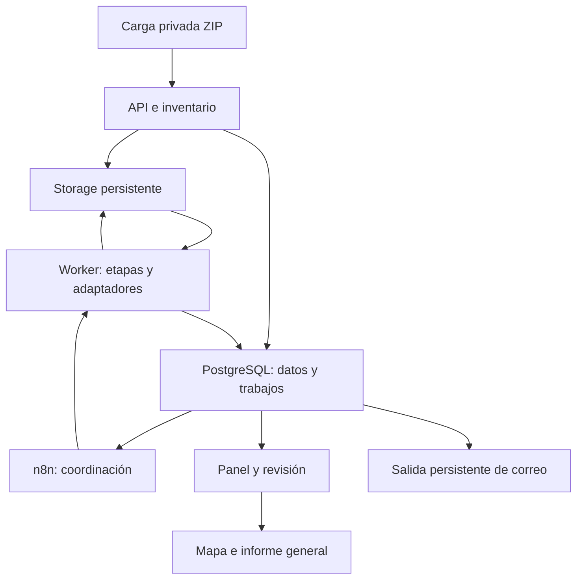

# Arquitectura y evolución

Estado: diseño aprobado; implementación por etapas. Fecha: 2026-11-08.

## Decisión de diseño

Aplicación Python modular con API y trabajador separados como procesos, compartiendo contratos y código. PostgreSQL mantiene registros y estados; archivos en volúmenes persistentes. n8n coordina llamadas a la API. Ollama sirve el modelo textual. Audio y visión son adaptadores intercambiables del trabajador. Evitar un microservicio por función y dependencias pesadas de MLOps sin una necesidad medida.

## Límites de módulos propuestos

| Módulo | Responsabilidad | Contrato de salida |
|---|---|---|
| ingestion | ZIP, versiones y mensajes | IDs y manifiesto de originales |
| media | Audio y cuadros de video | Derivados, tiempos y origen |
| adapters/audio | Transcripción | Texto completo y segmentos |
| adapters/text | Extracción semántica | Afirmaciones con referencias |
| adapters/vision | Cajas y luces | Objetos, luces y no determinables |
| geography | Candidatos geográficos | Coordenadas, fuente y estado |
| reports | Consolidación de hechos | Reportes versionados, sin multiplicar por cuadros |
| evaluation | Etiquetas y métricas | Resultados por versión y conjunto |
| delivery | Panel, PDF y correo | Vistas públicas/privadas y notificaciones |

Un adaptador recibe IDs/localizadores autorizados, configuración validada y contexto de ejecución. Devuelve resultado, versión/modelo, tiempos, errores y referencias. No cambia por su cuenta el estado global del reporte ni envía correos. La capa de aplicación valida y persiste. Los logs y resultados técnicos no se mezclan con afirmaciones ciudadanas.

## Cambios sin rehacer el sistema

- Identificador y revisión exacta del modelo, parámetros y prompts fuera de la lógica de negocio.
- Contratos versionados: cambiar un modelo conserva el formato común o requiere una migración explícita.
- Migraciones de base numeradas y respaldadas; no recrear tablas al reiniciar.
- Reprocesar una etapa seleccionada y conservar la salida anterior. Caché por entrada + modelo + configuración + prompt + versión de procesamiento.
- Nuevos campos opcionales primero; eliminar/renombrar exige migración y actualizar API, vistas, pruebas y diccionario.
- Predicción y corrección humana se almacenan separadas. Las métricas indican contra qué etiquetas se calcularon.
- Cola canónica en PostgreSQL; n8n solicita trabajo, pero no mantiene un segundo estado contradictorio. Adquisición atómica y lease para recuperación.
- Una tarea pesada a la vez inicialmente. Límites reales y descarga de modelos ajustados según memoria medida.

## Flujo de una mejora

Rama de cambio → pruebas automáticas → experimento privado con versión fija de datos → comparación con baseline → revisión → versión instalable → comprobación en VPS. Volver a una imagen anterior no revierte por sí solo una migración de datos: registrar compatibilidad y procedimiento de restauración.

La entrega inicial del repositorio preserva el prototipo como referencia funcional. Los módulos de esta arquitectura se implementarán gradualmente; la estructura descrita no implica que ya estén ejecutándose.

## Ingesta continua (actualización 2026-11-08)

La cantidad diaria y el tamaño de ZIP son variables; no codificar límites de 36 o 100 conversaciones. Recepción por bloques y validación posterior, antes de encolar inferencia. Mantener contadores separados de cargas, conversaciones y reportes. Comprobar espacio en disco y conservar reservas para los demás servicios. Una cola vacía sigue disponible para nuevas llegadas.

v0.4 implementa estas funciones en el prototipo SQLite de una réplica. La aplicación integrada deberá trasladar los estados a su persistencia PostgreSQL y probar concurrencia antes de aumentar réplicas. El máximo operativo depende de disco, memoria, tamaño descomprimido y recursos medidos.
